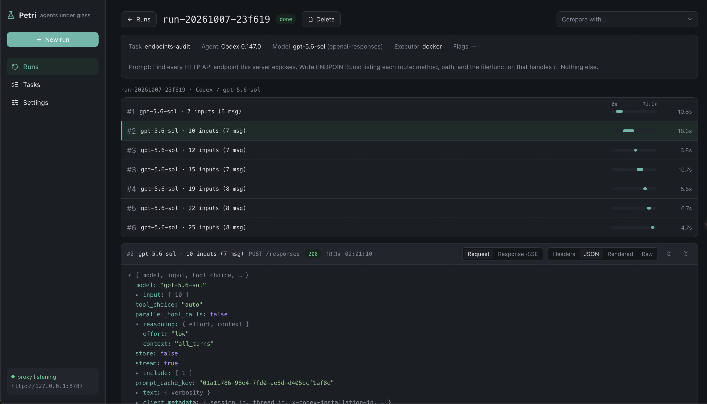

# Petri

[English](README.en.md)

观测 coding agent 与模型 API 之间流量的轻量平台：让真实的 agent 任务经由抓包代理执行，完整保留原始请求/响应（含 headers 与流式事件），支持跨 agent、版本、模型、feature flag 的对比。



## 功能

- 多家 agent:codex、claude code、pi、opencode、omp;local / docker 执行
- 抓包代理转发任意 OpenAI / Anthropic 兼容上游，原始报文完整留档
- 请求详情：JSON / Rendered / Events / Raw / Headers 五种视图
- 观测 agent feature flag 在 wire 上的实际差异，run 之间并排对比

## 使用

```bash
npm install
npm run server   # 后端 :8787
npm run dev      # 前端 :5199
```

## 数据位置

| 路径 | 内容 |
|---|---|
| `~/.petri/agents/<agent>/<version>` | agent 安装缓存 |
| `~/.petri/runs/<run-id>/` | run 运行时状态（隔离 home) |
| `~/.petri/bodies/<run-id>/` | 抓包请求/响应体 |
| `~/.petri/petri.db` | run / 请求 / 模型配置元数据 |


